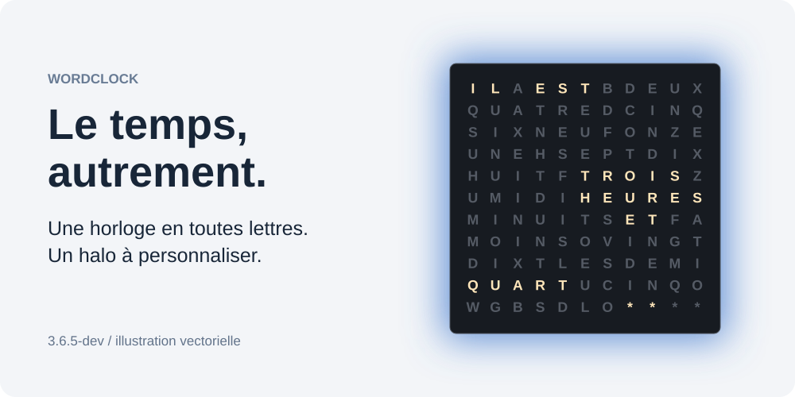
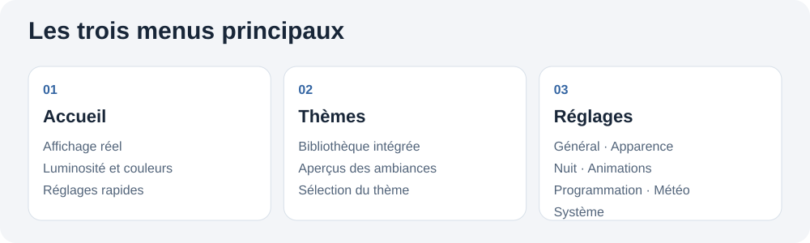
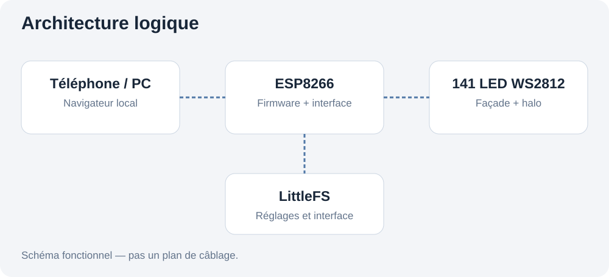

# Wordclock 3.0

**L'heure en toutes lettres. Une ambiance lumineuse qui vous ressemble.**



> **Statut : développement — 3.6.5-dev.** La version stable n'est pas encore publiée. Cette documentation décrit la branche `v3-development` ; les fonctionnalités peuvent évoluer.

Wordclock est une horloge connectée qui affiche l'heure en français à l'aide d'une matrice de LED. Un éclairage arrière indépendant crée un halo personnalisable. L'interface web locale permet de piloter l'horloge depuis un téléphone ou un ordinateur, sans installer d'application dédiée.

## Découvrir et utiliser

| Documentation | Contenu |
|---|---|
| [Démarrage rapide](docs/quick-start.md) | Connexion, heure et premier thème |
| [Mode d'emploi](docs/user-guide.md) | Toutes les commandes usuelles |
| [Dépannage](docs/troubleshooting.md) | Réseau, affichage, heure et mises à jour |
| [Matériel et développement](docs/hardware.md) | LED, architecture et compilation |
| [Mises à jour](docs/updates.md) | Installation, publication et récupération |
| [Notes de version](CHANGELOG.md) | Historique des modifications |

## Fonctionnalités

- Heure en français, par pas de cinq minutes, complétée par quatre étoiles.
- Éclairage avant et arrière : couleurs, intensité et animations indépendantes.
- Thèmes prédéfinis, aperçus animés et transitions entre thèmes.
- Aperçu de l'affichage réellement rendu par l'horloge.
- Mode nuit, animations des mots et programmations horaires ou calendaires.
- Ambiance météo expérimentale à partir des données Open-Meteo.
- Synchronisation Internet de l'heure, réglage manuel et accès Wi-Fi direct hors ligne.
- Distribution séparée du firmware signé et de l'interface web, restauration de l'interface précédente.



## Architecture



| Élément | Configuration |
|---|---|
| Microcontrôleur | Wemos D1 R1 / ESP8266 (PlatformIO `d1`) |
| Façade | 11 × 11 LED WS2812, dont 4 indicateurs de minutes |
| Arrière | 20 LED WS2812 |
| Logiciel | Arduino, FastLED, WiFiManager, ArduinoJson |
| Stockage | LittleFS |
| Accès local | `http://wordclock.local` ou adresse IP |

## Développement

Installer Git, Python et PlatformIO (CLI ou extension VS Code), puis :

```bash
git clone -b v3-development https://github.com/ccachin/Wordclock-2.0.git
cd Wordclock-2.0
pio run -e d1
```

Pour le téléversement USB, la préparation de LittleFS et les mises à jour, consulter le [guide technique](docs/hardware.md) et les [instructions de publication](docs/updates.md). Ne pas écraser le stockage d'un appareil configuré sans sauvegarde.

## Sécurité et limites

L'interface est prévue pour un réseau local de confiance ; ne pas exposer ses ports sur Internet. Les opérations de maintenance et d'installation nécessitent actuellement un mot de passe administrateur. Sans RTC, une coupure électrique suivie d'un démarrage hors ligne nécessite une nouvelle synchronisation de l'heure. Le mode météo transmet les coordonnées à Open-Meteo via HTTP non chiffré.

## Historique et contribution

Consulter [CHANGELOG.md](CHANGELOG.md) et les [issues GitHub](https://github.com/ccachin/Wordclock-2.0/issues). Pour signaler un problème, préciser les versions du firmware et de l'interface, les étapes de reproduction et, si possible, un diagnostic système sans données sensibles.

*Les illustrations de cette documentation sont des schémas vectoriels, pas des photographies ni des captures d'écran.*
