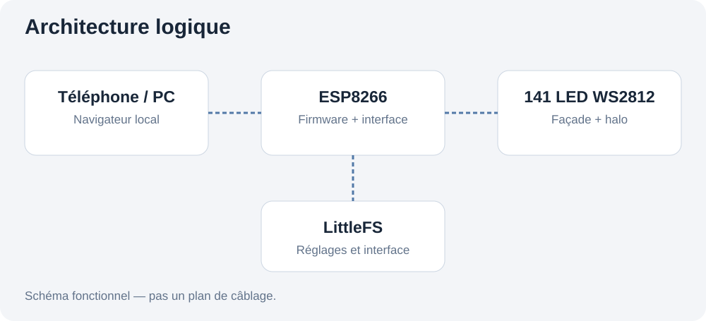
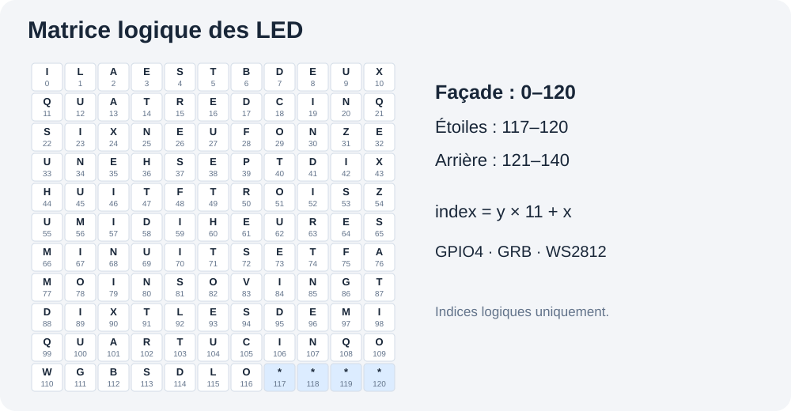

# Matériel et développement

[Retour au README](../README.md)

## Configuration vérifiée dans le code

- Wemos D1 R1 / ESP8266, environnement PlatformIO `d1`.
- Chaîne logique de 141 LED WS2812, ordre GRB, signal GPIO4 (numéro GPIO et non nom sérigraphié).
- Indices 0 à 120 : façade 11 × 11 ; indices 117 à 120 : étoiles de minutes ; indices 121 à 140 : éclairage arrière.
- Mapping logique `index = y * 11 + x`.
- LittleFS ; pas de RTC.

Ce document n'est pas un plan de câblage électrique validé : brochage du PCB, alimentation, protections, sections de fils, capacité de courant et sens physique de la chaîne doivent être vérifiés sur l'appareil réel. Ne pas alimenter l'ensemble des LED à travers la carte ESP sans validation du chemin de puissance. Une alimentation 5 V adaptée, une masse commune et une interface de données compatible doivent être prévues dans le montage réel.

## Organisation des sources

| Chemin | Rôle |
|---|---|
| `src/`, `include/` | Firmware C++ et modules |
| `data/www/` | Interface embarquée |
| `tools/` | Construction, publication et validation |
| `test/` | Tests natifs |
| `studio-legacy/` | Anciennes ressources Studio |
| `docs/` | Documentation |

## Construire

Depuis la branche `v3-development`, lancer `pio run -e d1`. Le projet utilise espressif8266 4.2.1, FastLED 3.10.10, WiFiManager 2.0.17 et ArduinoJson 6.21.5. Le moniteur série fonctionne à 115200 bauds.

Pour un appareil de développement physiquement connecté, `pio run -e d1 -t upload` téléverse le firmware par USB. Vérifier le port et le mode de démarrage propres au matériel. Ne pas utiliser `uploadfs` sur une horloge en service sans connaître les conséquences sur les réglages et les slots web. Préférer le mécanisme de mise à jour documenté dans [updates.md](updates.md).

Ne jamais distribuer les environnements privés `d1_migration` et `d1_weather_diag`. L'environnement `d1_ota` est destiné au développement autorisé ; son mot de passe provient de la variable d'environnement `WORDCLOCK_OTA_PASSWORD`.

## Références internes existantes

[Horloge hors ligne](offline-clock.md) · [Publications signées](signed-release.md) · [Session firmware](firmware-session.md) · [Diagnostic météo](weather-diag.md).
