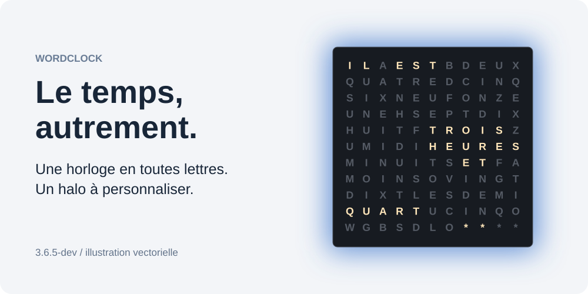

# Documentation Wordclock 3.0

Version de référence : 3.6.5-dev (développement).

- [Démarrage rapide](quick-start.md)
- [Mode d'emploi](user-guide.md)
- [Dépannage](troubleshooting.md)
- [Matériel et développement](hardware.md)
- [Mises à jour et récupération](updates.md)
- [Retour au projet](../README.md)
