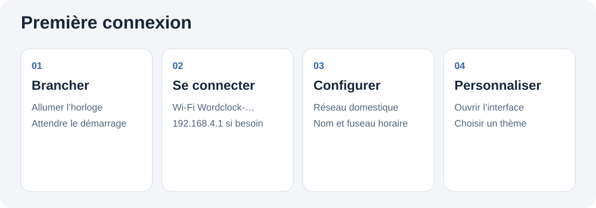

# Démarrage rapide

[Accueil du projet](../README.md) · [Mode d'emploi complet](user-guide.md)

## 1. Allumer la Wordclock

Brancher son alimentation prévue par le fabricant. Attendre le démarrage. Sur une horloge déjà configurée, connecter le téléphone ou l'ordinateur au même réseau Wi-Fi et ouvrir `http://wordclock.local`.

## 2. Connecter une nouvelle horloge

Dans les réglages Wi-Fi du téléphone, rechercher le réseau `Wordclock-Setup` ou `Wordclock-` suivi d'un identifiant. Pour les builds de développement actuels, le mot de passe de ces points d'accès est `Wordclock123` (identifiant partagé provisoire, non destiné à une version stable). Si aucune page ne s'ouvre, saisir `http://192.168.4.1/` dans le navigateur.

- Si le portail propose les réseaux Wi-Fi, choisir son réseau 2,4 GHz et saisir son mot de passe.
- Si l'interface normale s'ouvre directement, aller dans **Réglages → Général → Connexion Wi-Fi → Changer de réseau Wi-Fi** pour lancer le portail. Selon l'état de provisionnement, une autorisation peut être nécessaire.

Rejoindre ensuite le réseau domestique et ouvrir l'adresse locale de l'horloge. Si celle-ci échoue, utiliser l'adresse IP affichée dans le routeur ou dans l'interface de l'horloge.

## 3. Configurer l'horloge

L'assistant propose quatre étapes : nom, fuseau horaire, couleur réelle de la façade (pour les aperçus), puis confirmation. Choisir le fuseau correspondant à son lieu de résidence. L'heure se synchronise normalement par Internet ; sinon, dans **Réglages → Général → Heure et date**, choisir **Synchroniser avec cet appareil**.

## 4. Choisir une ambiance

Dans **Thèmes**, sélectionner un thème. Dans **Accueil**, régler la luminosité globale et les intensités avant/arrière. Pour retrouver facilement l'interface, utiliser **Réglages → Général → Accéder à mon horloge → Ajouter l'application à l'écran d'accueil** et suivre les instructions adaptées au téléphone.

[En cas de problème](troubleshooting.md)
