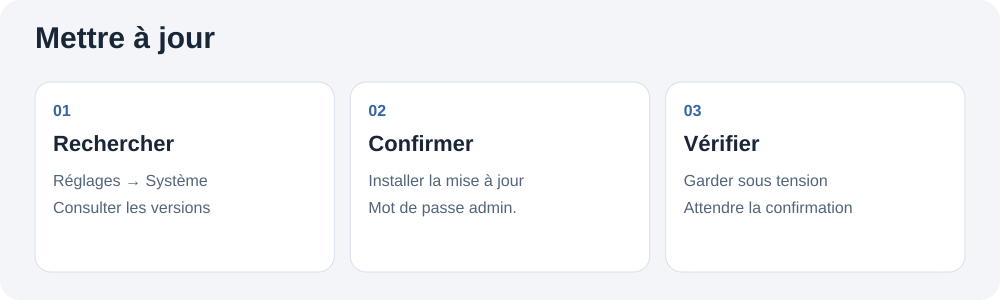

# Mises à jour et récupération

[Retour au mode d'emploi](user-guide.md)

## Installer depuis l'interface

1. Connecter le navigateur à l'horloge sur le réseau local et disposer d'un accès Internet pour télécharger les fichiers.
2. Ouvrir **Réglages → Système → Mises à jour**.
3. Cliquer sur **Rechercher des mises à jour**. Consulter les versions et notes proposées.
4. Si une mise à jour adaptée est disponible, cliquer sur **Installer la mise à jour**, confirmer et saisir le mot de passe administrateur demandé.
5. Garder la page ouverte et l'alimentation stable pendant les téléchargements, transferts et éventuel redémarrage. Attendre la confirmation de la version finale.

Le canal stable est encore en préparation. Le canal **Expérimental** est destiné aux essais, pas à une distribution grand public. Le firmware et l'interface peuvent être proposés séparément ; lorsque les deux sont proposés, le client installe le firmware avant l'interface.

## Récupération

Dans les options avancées, **Restaurer l'interface précédente** permet de revenir à un slot web précédent s'il est disponible. Ce n'est pas un retour arrière du firmware. La page locale `/recovery` peut servir lorsque l'interface normale est indisponible. En cas de résultat non confirmé, vérifier les versions et l'état système avant de relancer. Si nécessaire, contacter le mainteneur pour une récupération USB. Ne pas couper l'alimentation pendant l'activation.

## Mainteneurs : préparation et publication

Consulter les [instructions de publication signée existantes](signed-release.md) avant toute opération. `python tools/prepare_release.py` prépare une publication générique signée ; `--web-only` permet de préparer une publication web seule. La clé privée doit rester hors du dépôt. Vérifier les artefacts, la compatibilité API et les octets indexés ; la publication passe par `tools/publish_release.py` et un checkout séparé de `gh-pages`. Le commit et le push restent des opérations manuelles. Ne pas publier de build de migration ou de diagnostic, ni activer la distribution stable avant validation matérielle et sécurité.

Les mécanismes de signature et d'intégrité ne constituent pas une garantie absolue contre les interruptions ou une erreur de publication. La simplification future de l'authentification utilisateur n'est pas considérée comme implémentée dans cette documentation.
