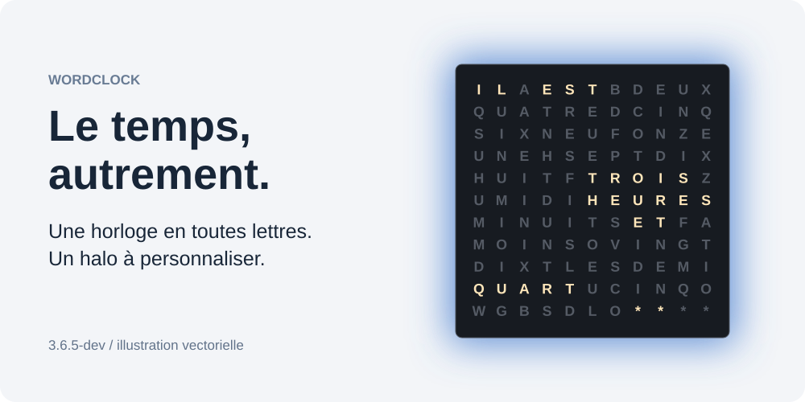
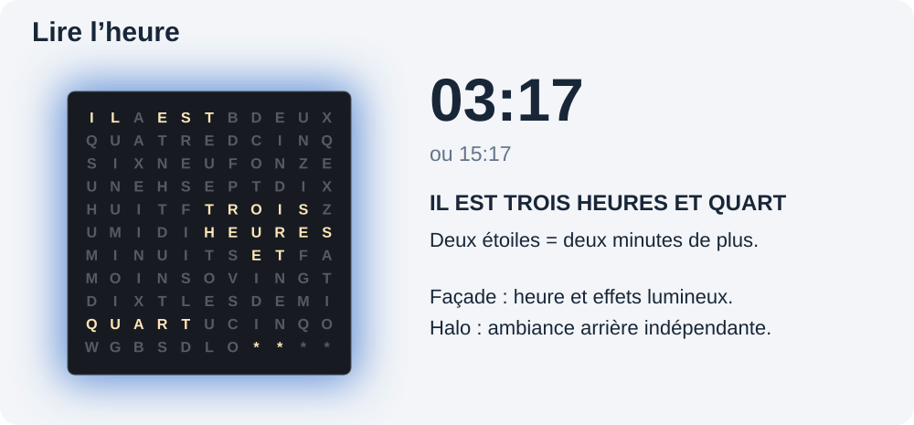
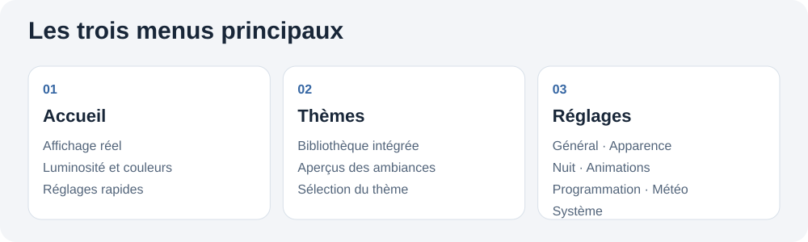
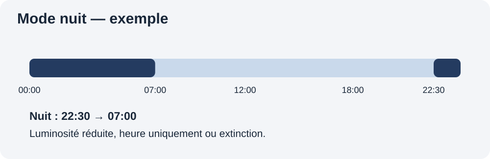

# Wordclock — Mode d'emploi

Guide correspondant au code 3.6.5-dev. Les libellés et les fonctions peuvent évoluer avant la version stable.

[Première installation](quick-start.md) · [Dépannage](troubleshooting.md) · [Accueil du projet](../README.md)

## Lire l'heure

Les mots indiquent l'heure au dernier multiple de cinq minutes. Les quatre étoiles en bas indiquent chacune une minute supplémentaire. Par exemple, « IL EST TROIS HEURES ET QUART » avec deux étoiles allumées correspond à 3 h 17 (ou 15 h 17).

## Se déplacer dans l'interface

Ouvrir l'adresse locale de l'horloge depuis un navigateur sur le même réseau. Le bouton **Mode sombre** modifie l'apparence de l'interface, pas l'éclairage réel de l'horloge.

## Accueil : modifier l'ambiance

L'aperçu **Affichage actuel** représente le rendu de l'horloge et son mode effectif. Un mode automatique peut donc afficher une ambiance différente du thème choisi manuellement.

- **Luminosité** : régler l'intensité générale ou éteindre l'horloge. Les curseurs avant et arrière ajustent chaque zone séparément.
- **Réglages rapides de l'ambiance** : choisir les couleurs, l'harmonie et les animations. L'avant offre notamment fixe, respiration et cycle de couleurs ; l'arrière ajoute arc-en-ciel et chenillard. Adapter la vitesse lorsque le réglage est disponible.
- **Mode météo** : activer ou désactiver l'ambiance météo, puis accéder à ses réglages.

## Thèmes

Ouvrir **Thèmes** et choisir une ambiance de la bibliothèque intégrée. Les vignettes montrent un aperçu indicatif de la façade et du halo ; leur rythme peut différer du rendu réel. Le thème sélectionné peut être temporairement remplacé par une programmation, le mode météo ou le mode nuit. La bibliothèque locale actuelle est centrée sur les thèmes usine ; ne pas supposer que l'importation de thèmes est disponible.

## Réglages : Général et Apparence

**Général** permet de modifier le nom, le fuseau horaire, l'heure et la date, le réseau Wi-Fi et les raccourcis d'accès. Pour régler l'heure sans Internet, synchroniser avec le téléphone ou appliquer une date et une heure locales manuellement. Une connexion Internet ultérieure peut remplacer le réglage manuel par l'heure réseau.

**Apparence** : choisir la couleur réelle de la façade pour rendre les aperçus plus fidèles. Ce paramètre ne modifie pas le matériau de l'horloge. Activer ou désactiver le fondu entre thèmes et ajuster sa durée.

## Mode nuit

Dans **Réglages → Mode nuit**, activer la fonction, saisir les heures de début et de fin, puis sélectionner le comportement : luminosité réduite, heure uniquement ou extinction complète. Pour le premier mode, choisir une luminosité maximale confortable. Vérifier que les valeurs ont été prises en compte.

## Animations

Dans **Réglages → Animations**, activer les effets si souhaité. Choisir la transition des mots (fondu, balayage, Matrix, apparition progressive, explosion, dissolution, vague diagonale, scanner, étincelles ou onde circulaire). Régler aussi les effets permanents, la palette horaire et le coucou lumineux. Les options de durée et d'intensité concernent les effets prévus par l'interface. **Rejouer l'aperçu** simule localement l'effet ; **Tester** le joue sur l'horloge. Sélectionner **Enregistrer les animations** pour conserver les modifications.

## Programmation

Dans **Réglages → Programmation**, sélectionner **Ajouter une programmation**. Choisir une action (changer de thème, limiter la luminosité, jouer une animation), une heure ou une plage selon l'action, les jours et éventuellement une date particulière. Enregistrer. Exemple : limiter la luminosité à 25 % de 20 h à 22 h les jours de semaine. Les modes automatiques peuvent se superposer ; le mode nuit et l'arrêt manuel restent prioritaires.

## Météo (expérimental)

Dans **Réglages → Météo**, activer le mode, rechercher une ville et choisir le résultat, ou saisir les coordonnées manuellement. Choisir conditions actuelles ou prévision à environ une heure, la zone éclairée et l'intensité du mélange. La simulation locale est indicative et ne change pas l'horloge. Enregistrer puis actualiser si nécessaire. Une connexion Internet est requise pour obtenir de nouvelles données. Les programmations et le mode nuit restent prioritaires. Les coordonnées sont transmises à Open-Meteo par HTTP non chiffré.

## Système et mises à jour

Dans **Réglages → Système**, consulter les versions, rechercher une mise à jour ou afficher les informations système. Les opérations sensibles demandent un mot de passe administrateur. Les versions expérimentales peuvent contenir des erreurs ; ne pas changer de canal sans comprendre les risques. Ne pas couper l'alimentation pendant une installation. Voir [Mises à jour](updates.md).

Le redémarrage ne réinitialise pas les données. **Réinitialiser les réglages** restaure les réglages d'éclairage ; **Restaurer les paramètres d'usine** efface les données personnelles et nécessite une nouvelle configuration. Ne pas utiliser cette dernière commande pour résoudre un simple problème de connexion sans avoir tenté les autres solutions.

## Utilisation hors ligne

L'horloge peut continuer à afficher une heure déjà synchronisée même si Internet disparaît. Si le réseau Wi-Fi est inaccessible, rejoindre son point d'accès direct `Wordclock-…` et ouvrir `http://192.168.4.1/`. Une coupure d'alimentation fait perdre l'heure valide en l'absence de RTC : resynchroniser depuis le téléphone après un démarrage hors ligne.
